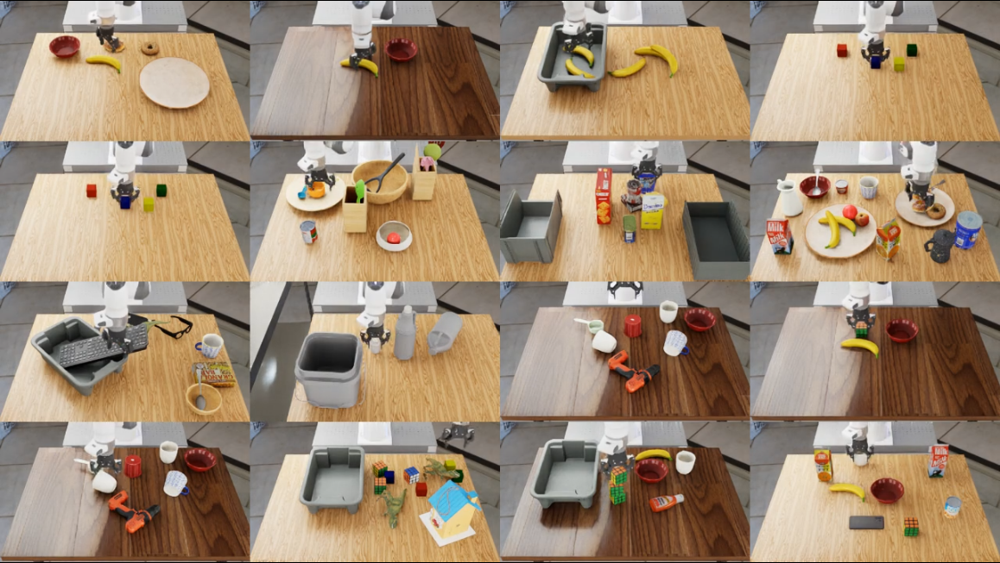

# Franka tabletop pick-and-place in NVIDIA Isaac Lab

**classical planner · learned end-effector tracker · damped least-squares IK · 8-D joint targets**

[](https://docs.omniverse.nvidia.com/isaacsim/latest/overview.html)
[](https://isaac-sim.github.io/IsaacLab)
[](https://docs.python.org/3/whatsnew/3.12.html)
[](https://github.com/leggedrobotics/rsl_rl)
[](LICENSE)



**task-franka-tabletop-rl** is a [Nepher Robotics](https://github.com/nepher-ai) extension for [NVIDIA Isaac Lab](https://isaac-sim.github.io/IsaacLab) / [Isaac Sim](https://docs.omniverse.nvidia.com/isaacsim/latest/overview.html). It trains a **Franka** arm with a **Robotiq 2F-85** gripper to pick and place objects on a tabletop benchmark. A classical planner chooses each grasp and place pose. An **RSL-RL PPO** policy tracks that tool pose. **Damped least-squares IK** turns the tracker action into **8-D absolute joint targets**.

Use this repository when you need Isaac Lab Gym environments for Franka **tabletop pick-and-place** (`Nepher-FrankaTabletopRL-LL-*`, `Nepher-FrankaTabletopRL-HL-*`), a LeRobot v2.1 dataset of successful episodes, or the EnvHub benchmarks `franka-tabletop-rl-v0`, `franka-tabletop-rl-v1`, `franka-tabletop-rl-v2`, and `franka-tabletop-rl-v3`.

Agents: start at [`llms.txt`](llms.txt) (index) or [`llms-full.txt`](llms-full.txt) (single-file context).

| | |
|---|---|
| **Robot** | Franka with a Robotiq 2F-85 gripper |
| **Simulator** | NVIDIA Isaac Sim 6.1.0 + Isaac Lab 3.0 |
| **Algorithm** | rsl_rl PPO end-effector tracker |
| **Stack** | Classical planner → PPO tracker → damped least-squares IK → 8-D joint targets |
| **Rates** | Physics 120 Hz. Commands every 8 steps (15 Hz) |
| **Tracker observation** | 43 values: arm position and velocity, gripper, tool pose, pose error, pose target, grip target, last action |
| **Tracker action** | 7-D tool-pose delta plus gripper, integrated to absolute joint targets |
| **Recorded action** | 8 values: 7 absolute joint targets [rad], gripper 0 (open) or 1 (closed) |
| **Success** | The task predicate holds on the current state for 0.5 s |
| **Eval** | EnvHub `franka-tabletop-rl-v0` (default), plus `v1`, `v2`, and `v3` |
| **License** | BSD 3-Clause |

## Who this is for

- Researchers training a **Franka end-effector tracker** in Isaac Lab, then running it under a classical pick-and-place planner.
- Teams collecting a **LeRobot v2.1** dataset of successful tabletop episodes, with joint targets and the four scene cameras.
- Benchmarks on the EnvHub bundles **`franka-tabletop-rl-v0`** through **`franka-tabletop-rl-v3`**. The high-level env puts every selected task in one stage.

The package collects training data for a downstream policy. It does not open a socket and it does not ship a brain image. The tournament scene those policies are scored on is `task-franka-tabletop`.

## How it runs

```
classical planner (hl_policy) -> learned end-effector tracker (ll_policy) -> damped-least-squares IK -> 8-D joint targets
```

Train the tracker first, then play the planner on top of that checkpoint.

- **High level.** `ClassicalTabletopPlanner` picks each object a task asks to move. It searches a top-down grasp on the object's mesh, carries the object to the pose that satisfies that goal, lets go, and retries a failed grasp. A task that must be left upright is left alone and scores 0. The planner reads latched benchmark progress and stops when the task is done.
- **Low level.** The PPO policy tracks the planner's tool pose and gripper command. Its 7-D action is a tool-pose delta plus the gripper. `IkJointCommandAction` turns that into absolute joint targets, the same 8-D action space a downstream policy writes.
- **Scene.** The robot, physics, sensors, and success predicates match `task-franka-tabletop` at commit `4d64971`. They live in `franka_tabletop_rl/scene/` and `franka_tabletop_rl/benchmark/`. `tests/test_parity.py` checks them, so a recorded trajectory is valid training data for that benchmark.

### Episode success

The success expression has to hold on the current state, with no memory of earlier grasps or placements, and it has to keep holding for 0.5 s. An object that must be moved has to be free of the fingers (a stack is exempt), and a pickup has to still be in them. `in_order` keeps only the first-placement step of each object. Contact-force checks are not ported, so `stacked` also needs the lowest corner within 1 cm of the support top. `front` is toward the robot (-x) and `behind` is away from it (+x). A lost object ends the episode as a failure and never counts as success. The checks are in `franka_tabletop_rl/benchmark/success.py`.

## Gym environments

| Id | Use |
| --- | --- |
| `Nepher-FrankaTabletopRL-LL-v0` | Train the tracker (4096 envs, observation noise) |
| `Nepher-FrankaTabletopRL-LL-Play-v0` | Play the tracker |
| `Nepher-FrankaTabletopRL-HL-Play-v0` | Planner plus tracker on every selected task in one stage. Loads the latest tracker checkpoint |
| `Nepher-FrankaTabletopRL-HL-EnvhubPlay-v0` | The same layout, for eval-nav. Loads `best_policy/best_policy.pt` |

`./isaaclab.sh train` and `play` discover these through the `isaaclab.tasks` entry point.

Both high-level tasks load the EnvHub benchmark named by `env_id`. The default is `franka-tabletop-rl-v0` (`nepher download franka-tabletop-rl-v0`), 16 tasks. `franka-tabletop-rl-v1` is the full task set those smaller bundles are drawn from. `franka-tabletop-rl-v2` is 16 tasks taken from v1, one for each distinct set of success ops, including `one_bottle_in_square_pail`. `franka-tabletop-rl-v3` covers those same op sets and uses the next v1 task after v2 wherever v1 has another one. `one_bottle_in_square_pail` stays in v3.

**One stage, all tasks.** The high-level env builds one stage for the selected tasks (`env.task_id=all`, or one task id). Each benchmark has one background, named by its stage. `scene.num_envs` defaults to one env per task. `--num_envs` is that count or a whole multiple of it (`16`, `32`, `64`, ... for v0, v2, and v3). Env `i` runs task `i % T` and resets on its own, and every task is in the stage together. Unused object positions rest above the cameras. Because every env owns its meshes, the cloner builds one world per env (`replicate_physics=False`).

## Install

Isaac Sim has to run with its bundled Python, so every command goes through `./isaaclab.sh` from the Isaac Lab root. Inside that tree this package is `source/task-franka-tabletop-rl/source/franka_tabletop_rl`.

```bash
./isaaclab.sh -p -m pip install -e source/task-franka-tabletop-rl/source/franka_tabletop_rl
./isaaclab.sh -p -m pip install -e "source/task-franka-tabletop-rl/source/franka_tabletop_rl[record]"
```

The second line adds the LeRobot writer (`pyarrow`, `av`). TensorBoard logs are under this project, at `logs/rsl_rl/franka_tabletop_ll_ee_tracking`, not the Isaac Lab `logs` directory.

## Train and play

Isaac Lab 3 does not have a `--headless` flag. `--viz none` runs without a window. Playback runs until Ctrl+C. `--num_envs` for a high-level task defaults to one env per task, and a larger value has to be a multiple of that count. One task is `env.task_id=<task_id>`.

```bash
./isaaclab.sh train --task Nepher-FrankaTabletopRL-LL-v0 --num_envs 4096 --max_iterations 1500 --viz none
./isaaclab.sh play --task Nepher-FrankaTabletopRL-LL-Play-v0 --num_envs 64 --viz none
./isaaclab.sh play --task Nepher-FrankaTabletopRL-HL-Play-v0 --num_envs 64 --viz none
./isaaclab.sh play --task Nepher-FrankaTabletopRL-HL-Play-v0 --num_envs 4 env.task_id=throw_away_apple --viz none
```

`Nepher-FrankaTabletopRL-LL-Play-v0` and `Nepher-FrankaTabletopRL-HL-Play-v0` load the latest `model_*.pt` under `logs/rsl_rl/franka_tabletop_ll_ee_tracking` unless you pass `--checkpoint`. Copy the checkpoint eval-nav should load to `best_policy/best_policy.pt`. `Nepher-FrankaTabletopRL-HL-EnvhubPlay-v0` loads that file. The checkpoint is not committed.

### Highlight videos

`env.highlight=on` on `Nepher-FrankaTabletopRL-HL-Play-v0` or `Nepher-FrankaTabletopRL-HL-EnvhubPlay-v0` adds video recording and changes nothing else: the tasks, `--num_envs`, and layouts stay those of the same command. It writes `best_policy/videos/highlight/<camera>.mp4` for `cam_exterior_left`, `cam_exterior_right`, `cam_wrist`, and `cam_front`. Each is 1280x720, a 4x4 grid of 320x180 cells, and lasts one episode. The grid shows up to 16 tasks of the stage in benchmark order. A stage with more than 16 tasks shows 16 sampled with the seed. A stage with fewer leaves the remaining cells black. `env.highlight_tasks=0-15` films that inclusive range, and `0,5,12` films those indices, in that order instead of the sample. Only those envs are rendered, at the cell size. The process exits after the four clips are written.

```bash
./isaaclab.sh play --task Nepher-FrankaTabletopRL-HL-Play-v0 --num_envs 64 --viz none env.highlight=on
./isaaclab.sh play --task Nepher-FrankaTabletopRL-HL-Play-v0 --num_envs 64 --viz none env.highlight=on "env.highlight_tasks=0-15"
```

### LeRobot dataset

`scripts/record_lerobot.py` runs the planner and the tracker, and keeps the successful episodes as a LeRobot v2.1 dataset (`--cameras` records every camera as h264 video, and `--cameras cam_wrist cam_front` records those). It records all tasks at once, or one with `--task <task_id>`. `--episodes` is the number of successful episodes kept per task. `--num_envs` defaults to one env per task, and a larger value must be a multiple of the task count. It also copies the tracker it used to `best_policy/best_policy.pt`.

```bash
./isaaclab.sh -p source/task-franka-tabletop-rl/scripts/record_lerobot.py --episodes 8 --output datasets/tabletop_rl
./isaaclab.sh -p source/task-franka-tabletop-rl/scripts/replay_check.py --dataset datasets/tabletop_rl --episode 0
```

| Feature | Shape | Content |
| --- | --- | --- |
| `observation.state` | 8 | 7 joint positions [rad], gripper closure 0..1 |
| `observation.eef_pose` | 7 | tool position [m] and wxyz quaternion |
| `action` | 8 | 7 absolute joint targets [rad], gripper 0 (open) or 1 (closed) |
| `observation.images.<camera>` | H, W, 3 | `cam_exterior_left`, `cam_exterior_right`, `cam_wrist`, `cam_front` |

`meta/modality.json` declares the GR00T embodiment `franka_2f85_jointpos`. `scripts/replay_check.py` replays an episode recorded with `--jitter 0` in `task-franka-tabletop`'s own `TabletopEvalEnv`.

## FAQ

**What robot and simulator does this target?**
A Franka arm with a Robotiq 2F-85 gripper, in NVIDIA Isaac Sim 6.1.0 with Isaac Lab 3.0. Physics steps at 120 Hz. The policy command lands every 8 steps, at 15 Hz.

**What does the tracker observe and output?**
The observation is 43 values: 7 arm positions, 7 arm velocities, gripper, 7-D tool pose, 6-D pose error, 7-D pose target, grip target, and the last 7-D action. The action is a 7-D tool-pose delta plus the gripper. `IkJointCommandAction` integrates it with damped least-squares IK into absolute joint targets.

**How is an episode a success?**
The task predicate has to be true on the current state and stay true for 0.5 s. Earlier grasps and placements are not remembered, except the first-placement step that `in_order` compares. A lost object ends the episode as a failure.

**Which Gym ID should I start with?**
Train `Nepher-FrankaTabletopRL-LL-v0`, then play the planner with `Nepher-FrankaTabletopRL-HL-Play-v0`. For eval-nav, copy the checkpoint to `best_policy/best_policy.pt` and use `Nepher-FrankaTabletopRL-HL-EnvhubPlay-v0`.

**Which EnvHub bundle loads by default?**
`franka-tabletop-rl-v0` (16 tasks). Select another with `env_id`, for example `env_id=franka-tabletop-rl-v1`. Download it first: `nepher download <env_id>`.

**Where does the tracker checkpoint load from?**
`Nepher-FrankaTabletopRL-LL-Play-v0` and `Nepher-FrankaTabletopRL-HL-Play-v0` load the latest `model_*.pt` under `logs/rsl_rl/franka_tabletop_ll_ee_tracking` unless you pass `--checkpoint`. `Nepher-FrankaTabletopRL-HL-EnvhubPlay-v0` loads `best_policy/best_policy.pt`.

## License

Copyright (c) 2026, [Nepher Robotics](https://github.com/nepher-ai). All rights reserved.
Distributed under the [BSD 3-Clause License](LICENSE).

**Keywords:** Franka, Robotiq 2F-85, pick-and-place, tabletop, reinforcement learning, PPO, hierarchical policy, inverse kinematics, LeRobot, NVIDIA Isaac Lab, Isaac Sim, rsl_rl, EnvHub, franka-tabletop-rl-v0, Nepher.
